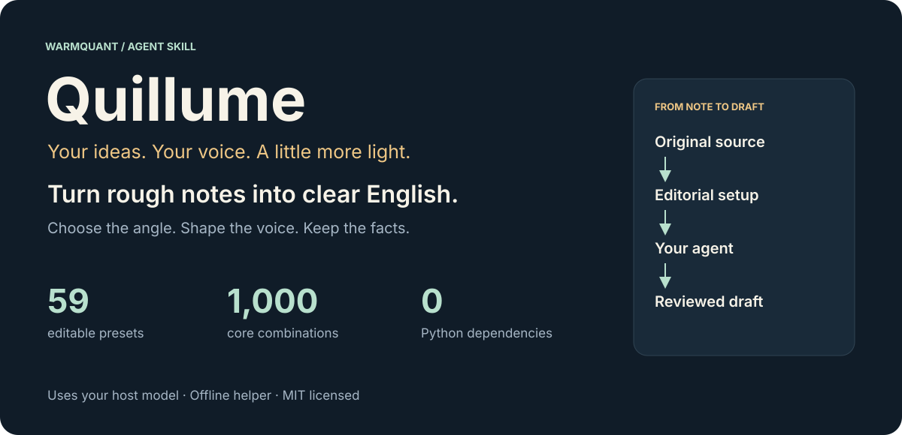
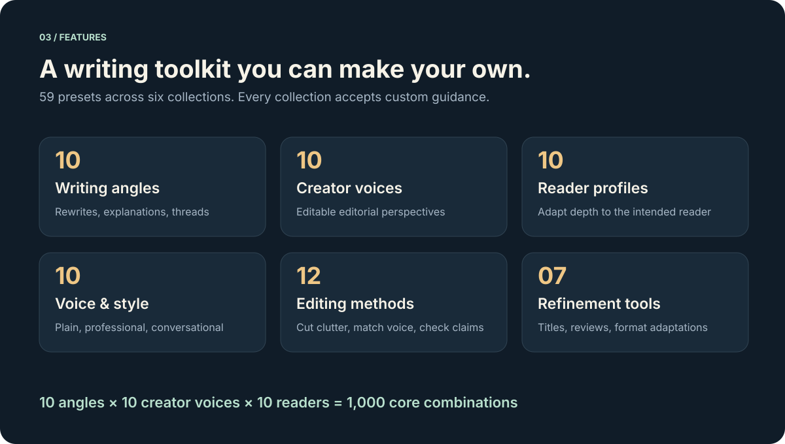
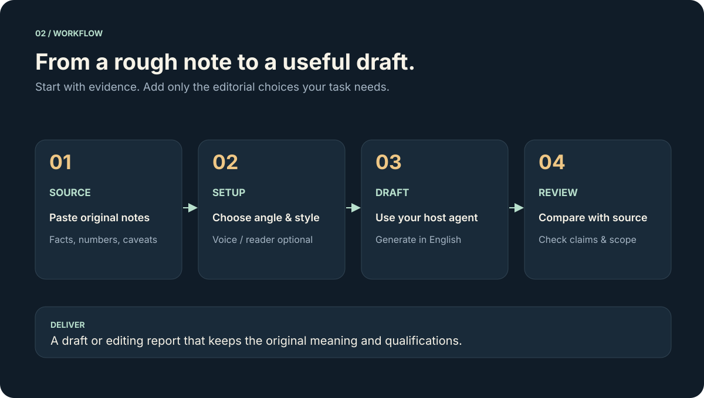
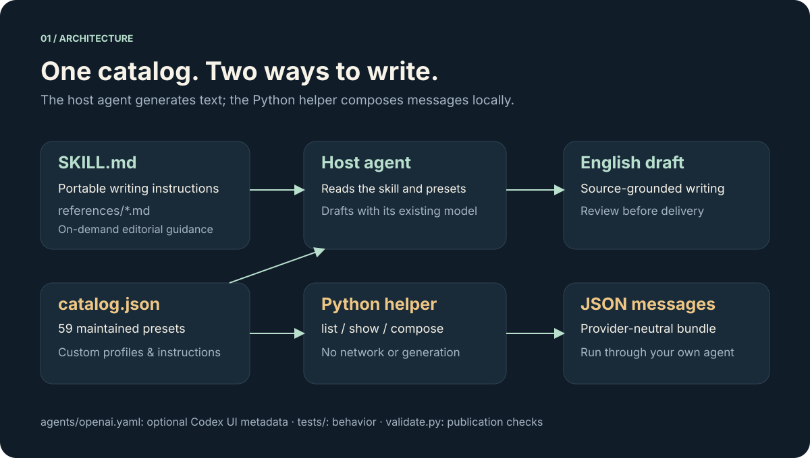

<div align="center">



# Quillume

**Turn rough notes into clear English—with your voice and your facts intact.**

An open-source writing skill for your existing agent. Built by **WarmQuant**.

**59 editable presets · 1,000 core combinations · Offline Python helper · MIT**

[Get started](#get-started) · [See it in action](#see-it-in-action) · [Explore presets](references/presets.md) · [Customize](references/customization.md)

</div>

## Good ideas deserve a better draft

You have the notes. You know what happened. Quillume helps you find the angle, write for the reader, and turn those fragments into something worth reading.

Use it for a founder update, a beginner explanation, a thoughtful reply, a thread, or a longer article. Choose a voice and style when they help—or simply ask for a clearer rewrite. The skill guides your host agent to preserve numbers, names, qualifications, and the limits of your evidence.

**Bring the source. Choose the direction. Let your agent write.**

## See it in action

**Your notes**

> We moved the internal reporting process from five steps to three. We tested one workflow. We have not measured customer time savings.

**Your request**

```text
Use $quillume to make these notes clearer.
Keep it to two sentences, in plain English.
```

**Illustrative draft**

> In one tested internal workflow, reporting now takes three steps instead of five. Customer time savings have not yet been measured.

The useful detail survives: the actual change, the single-workflow scope, and the unmeasured outcome. This is a fictional editorial example, not a customer result or a model benchmark. See the [expanded example](examples/draft.md) and [worked examples](references/examples.md).

## Get started

### 1. Install the skill

Download or clone this repository into a folder named `quillume`. Copy the whole folder to your agent host's skill directory, keeping `SKILL.md`, `references/`, `scripts/`, and `agents/` together.

For Codex, run this from the repository root:

```sh
mkdir -p ~/.codex/skills
# Use a fresh destination; move an existing installation aside before copying.
mkdir ~/.codex/skills/quillume
cp -R SKILL.md LICENSE agents references scripts ~/.codex/skills/quillume/
```

Reload your host's skill catalog or restart it if needed. Other hosts use their own skill locations and invocation syntax. `SKILL.md` is the portable entrypoint; `agents/openai.yaml` provides optional Codex UI metadata.

### 2. Give it your notes

In Codex:

```text
Use $quillume to expand these notes into a short update for busy founders.
Use the indie-founder voice, Professional style, and claim-aware editing.

Source:
We reduced the internal weekly reporting workflow from five steps to three.
We checked one workflow. Customer time savings have not been measured.
```

You can also ask for a rewrite without selecting presets. Defaults are **clear rewrite + plain language**, with no assumed author identity or audience. Drafts are English; setup discussion can use your language.

### 3. Review and use the draft

Check it against your source before sharing. Quillume instructs the agent to review factual fidelity, but results depend on your host model. Saving or publishing content remains a separate action you request.

## Your writing, with more range



| Collection | Count | What it changes |
| --- | ---: | --- |
| Writing angles | 10 | The shape: rewrite, deep dive, story, explanation, reply, thread |
| Creator voices | 10 | The editorial perspective and tone |
| Reader profiles | 10 | The depth, context, and emphasis for the intended reader |
| Voice & style | 10 | The rhythm: plain, professional, concise, warm, analytical |
| Editing methods | 12 | The treatment: cut clutter, match voice, review claims |
| Refinement tools | 7 | The next task: titles, writing review, or format adaptation |

**10 angles × 10 voices × 10 readers = 1,000 core combinations.** Styles and editing methods can accompany these combinations. A refinement tool performs its selected task instead of also producing the angle's format.

Every collection supports custom instructions or profiles. Creator voices describe editorial stances; reader profiles are editable hypotheses. They do not supply real credentials, experience, or customer research.

Browse the [full preset guide](references/presets.md), or inspect just what you need:

```sh
python3 scripts/quillume.py list --kind style
python3 scripts/quillume.py show creator indie-founder
python3 scripts/quillume.py show reader busy-founder
```

## How it works



Quillume runs as instructions inside your existing agent. Your host supplies the model; the skill supplies the editorial setup and review process. No separate WarmQuant account or API key is required. Your host's model limits, costs, and data policies still apply.



The optional Python helper is a local utility, not a text-generation service. It reads the shared catalog and your supplied source, then prints a provider-neutral JSON message bundle. It does not contact a service, read environment credentials, fetch links, or save drafts.

## Optional: compose prompts offline

**Python 3.10+ · Standard library only · No packages to install**

Run from the repository root:

```sh
# Build a message bundle from the included fictional notes.
python3 scripts/quillume.py compose --source examples/notes.txt \
  --angle expand --creator indie-founder --reader busy-founder \
  --style professional --prompt claim-aware

# Use your own editorial setup.
python3 scripts/quillume.py compose --source examples/notes.txt \
  --config examples/custom-setup.json

# Ask for a writing review instead of a new draft.
python3 scripts/quillume.py compose --source examples/notes.txt --tool check

# Or pipe source text through stdin.
printf '%s\n' 'One workflow changed. Customer savings are unmeasured.' \
  | python3 scripts/quillume.py compose --style concise
```

Ask your current agent to carry out the resulting writing task, or pass the bundle to a model through your own integration. The printed bundle contains your source and configuration; handle it as carefully as the input.

CLI choices override matching custom-setup fields. Use `none` to clear an optional creator, reader, editing method, or tool. Source input is limited to 20,000 characters.

## Make it yours

Start with [the custom setup example](examples/custom-setup.json). You can replace any preset with original instructions, supply voice samples, or describe a reader in your own terms.

To extend the shared library, add entries to [references/catalog.json](references/catalog.json). The helper discovers new entries without a build step. Keep `rewrite` and `plain` as default IDs, or update the defaults and documentation together.

Read [the customization guide](references/customization.md) for supported fields and validation rules. Voice samples guide expression; their factual claims are not treated as evidence for your draft.

## Built for source-grounded writing

- **Facts first.** Instructions preserve quantities and qualifications and check for unsupported additions.
- **Flexible voice.** Profiles adjust expression without inventing an identity or experience.
- **Small setup.** Use only the choices that improve the current task.
- **Local helper.** Prompt composition works offline with no runtime dependencies beyond Python.
- **Portable files.** Plain Markdown, JSON, and Python you can inspect and edit.

Quillume does not research an audience automatically, determine AI authorship, promise detector evasion, or publish on your behalf. Review drafts in your host before using them.

## Validate and contribute

```sh
python3 scripts/validate.py
python3 -m unittest discover -s tests -v
```

Validation checks skill structure, local documentation links, catalog consistency, common credential patterns, and private runtime artifacts. The 16 unit/CLI tests cover composition, customization, input handling, all 1,000 core combinations, and catalog extension. These checks validate the toolkit; they are not a benchmark of model writing quality.

GitHub Actions is configured to run validation and tests on Python 3.10 and 3.13. When contributing a preset, keep it original, source-grounded, and useful for a specific editorial task. Update the guide when adding a collection entry, and run both checks.

```text
quillume/
├── SKILL.md                  Portable writing instructions
├── agents/openai.yaml        Optional Codex UI metadata
├── references/               Presets, customization, examples, sources
│   └── catalog.json          Shared preset library
├── scripts/                  Offline helper and publication validator
├── tests/                    Dependency-free behavioral tests
├── examples/                 Fictional source, draft, and custom setup
├── docs/images/              Editable README illustrations
└── LICENSE                   MIT license
```

## License and attribution

The code and original editorial templates are [MIT licensed](LICENSE). External framework references are listed in [sources](references/sources.md); linked publications are not included or relicensed, and links do not imply endorsement.

<div align="center">

**Your ideas. Your voice. A little more light.**

Quillume by WarmQuant

</div>
